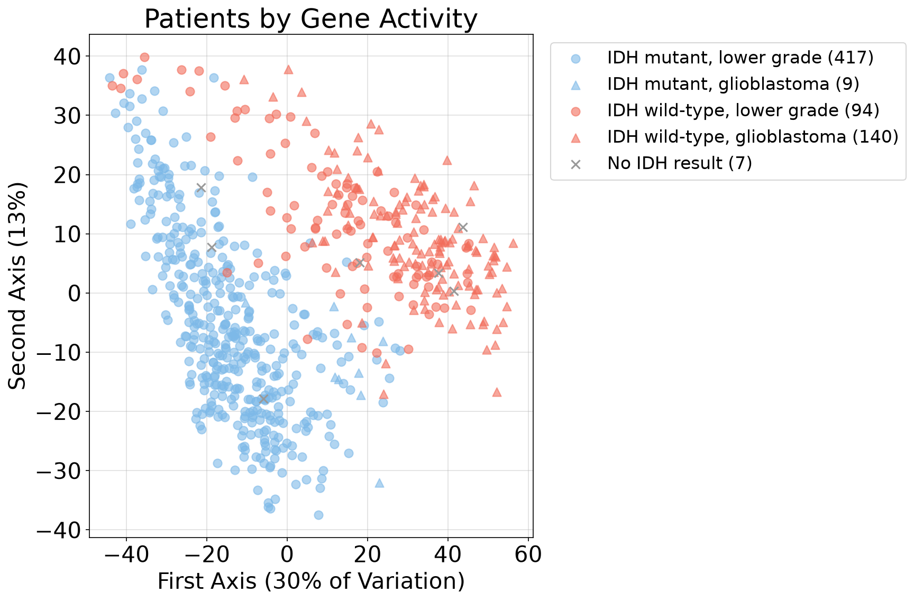
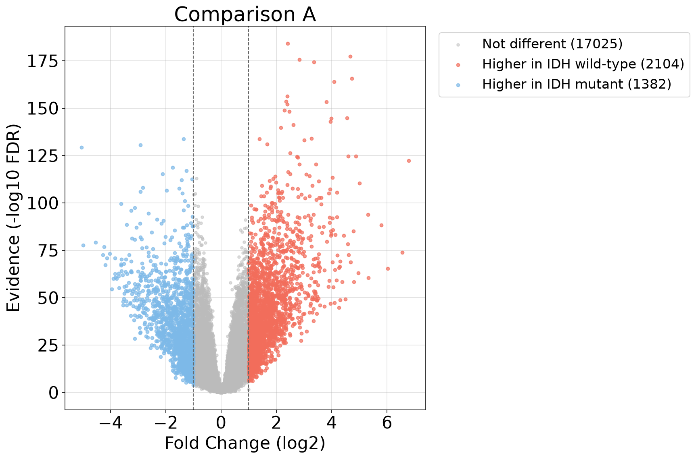
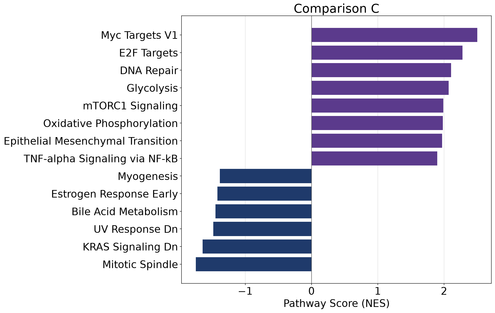
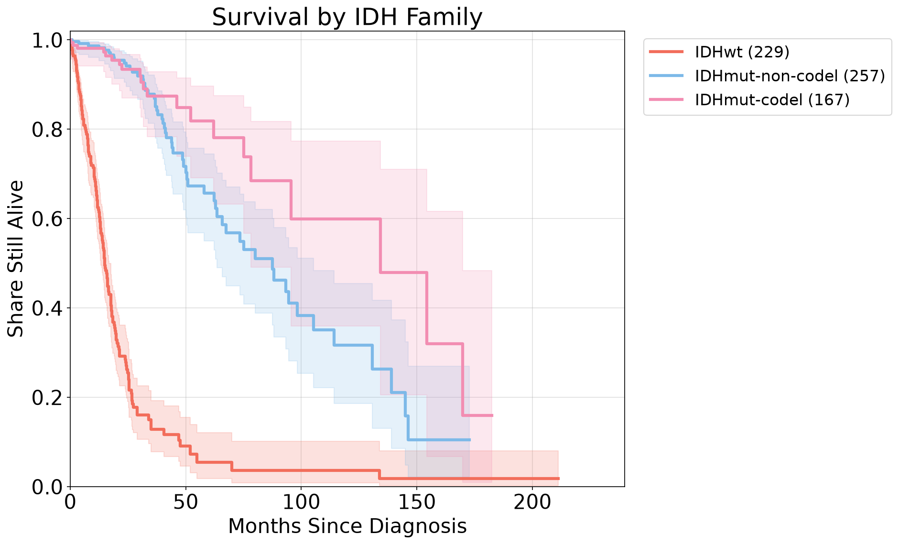

# What Separates a Slow Glioma From an Aggressive One?

A gene expression and survival analysis of 667 glioma patients from The Cancer Genome Atlas (TCGA), built on the 2016 Ceccarelli et al. paper in *Cell*.

## The Question

Gliomas are brain tumors that range from slow growing to very aggressive. Doctors have long sorted them by grade, which is how abnormal the tumor cells look under a microscope. The Ceccarelli paper found that a gene mutation called IDH tells you more about how a patient will do than grade does. I wanted to see this for myself in the data and ask three things.

1. Which genes are more or less active in IDH wild-type tumors (no IDH mutation, the more aggressive kind) compared with IDH mutant tumors?
2. Which biological pathways do those genes point to?
3. Do those groups really live different lengths of time?

## The Short Answer

- IDH wild-type tumors switch on genes for scar tissue, inflammation and immune cells. IDH mutant tumors keep more activity in genes for brain cell signaling.
- The same pathways turn up when comparing glioblastoma (the most aggressive grade) with lower grade tumors. Glioblastomas show more cell division, DNA repair and blood vessel growth.
- IDH status separates survival very strongly. Among lower grade tumors only, IDH wild-type patients had a median survival of 21.0 months against 95.6 months for IDH mutant patients.
- IDH status stays the biggest effect after age, sex and tumor grade are accounted for.
- These results agree with the Ceccarelli paper. They show an association, not a cause.

## Data

All data is public and comes from [cBioPortal](https://www.cbioportal.org/datasets). I used three studies.

| Study | What I used it for |
| --- | --- |
| `lgggbm_tcga_pub` | The paper's patient labels (IDH status, IDH and codeletion family, grade) and its survival |
| `lgg_tcga_pan_can_atlas_2018` | Gene expression for lower grade glioma, plus newer clinical data |
| `gbm_tcga_pan_can_atlas_2018` | Gene expression for glioblastoma, plus newer clinical data |

The files used from each study are `data_clinical_patient.txt`, `data_clinical_sample.txt` and `data_mrna_seq_v2_rsem.txt` (expression only, in the two PanCan studies). The raw downloads are not stored in this repository. See "How to run it" below. The `csv` folder holds my results tables, plus two patient tables the notebooks create from the public data.

## What I Did

| Step | Notebook | What it does |
| --- | --- | --- |
| 1 and 2 | `data_exploration.ipynb` | Loads the data, cleans it, matches patients across the downloads, and checks the numbers against the paper |
| 3 | `02_define_groups.ipynb` | Defines the patient groups and the three comparisons, and draws a PCA plot |
| 4 | `differential_expression.ipynb` | Finds genes that differ between groups, with a multiple-testing correction |
| 5 | `pathways.ipynb` | Finds which pathways those genes belong to |
| 6 | `survival.ipynb` | Kaplan-Meier survival curves, log-rank tests and Cox models |

### Key Decisions

- **Groups by IDH status, not grade.** More than half of IDH wild-type tumors are glioblastomas, so a plain mutant versus wild-type comparison could mix up an IDH effect with a grade effect. I ran three comparisons to separate them.
  - **A.** IDH wild-type versus IDH mutant, everyone (234 versus 426 patients).
  - **B.** IDH wild-type versus IDH mutant, lower grade only (94 versus 417). Genes found in both A and B are the most trustworthy.
  - **C.** Glioblastoma versus lower grade, IDH wild-type only (140 versus 94). This is the progression question.
- **Primary tumors only.** I kept only samples ending in `-01`, which gave 667 patients and 20,511 genes. The paper reports 667 patients with RNA-seq, so the match is close.
- **Newer survival for everyone.** The paper's download is older than the PanCan one. I used the newer follow-up for every patient and kept the paper's values in separate columns.
- **Genes were tested with Welch's t-test and the Benjamini-Hochberg correction.** A gene counts as different at an adjusted p-value below 0.05 and a fold change of at least 2 in either direction.
- **Age and sex check.** IDH wild-type patients are about 20 years older, so I reran each test with age and sex included. Almost every gene held up.
- **Two pathway methods.** GSEA on the 50 Hallmark pathways (ranking all genes), and an over-representation test on Gene Ontology biological processes (testing the lists of different genes).

## Results

### Patients separate by IDH status in gene activity



Each dot is a patient. IDH mutant tumors sit mostly on the left and IDH wild-type glioblastomas on the right. IDH wild-type lower grade tumors fall in between.

### Genes

| Comparison | Genes different | Higher in the more aggressive group | Higher in the other group |
| --- | --- | --- | --- |
| A | 3,486 | 2,104 | 1,382 |
| B | 2,441 | 1,643 | 798 |
| C | 1,617 | 668 | 949 |

2,187 of the 2,441 genes in B were also different in A. The top genes higher in IDH wild-type tumors include CHI3L1, POSTN, MEOX2 and LTF, which fit scar tissue and inflammation. The top genes higher in IDH mutant tumors include PRLHR, CSMD3, PCDH15 and SPHKAP, which are brain cell genes.



### Pathways



- Higher in IDH wild-type (A and B). Epithelial mesenchymal transition, interferon response, IL-6/JAK/STAT3 signaling and coagulation. Gene Ontology adds MHC class II assembly and extracellular matrix organization.
- Higher in IDH mutant. Synapse and nervous system development genes.
- Higher in glioblastoma (C). Myc targets, E2F targets (cell division), DNA repair, glycolysis, G2-M checkpoint and angiogenesis (blood vessel growth), plus inflammation and neutrophil movement.
- Higher in lower grade (C). Synaptic transmission and ion transport.

These match the progression findings in the Ceccarelli paper.

### Survival



| IDH family | Patients | Deaths | My median (months) | Paper's median (months) |
| --- | --- | --- | --- | --- |
| IDH wild-type | 229 | 160 | 15.0 | 14.0 |
| IDH mutant, non-codeleted | 257 | 57 | 87.5 | 75.1 |
| IDH mutant, codeleted | 167 | 21 | 134.3 | 115.8 |

| Comparison | Group 1 median (months) | Group 2 median (months) | Log-rank p |
| --- | --- | --- | --- |
| A, IDH wild-type vs mutant, everyone | 15.1 | 94.5 | 1.4e-77 |
| B, IDH wild-type vs mutant, lower grade only | 21.0 | 95.6 | 4.8e-29 |
| C, glioblastoma vs lower grade, IDH wild-type only | 13.3 | 21.0 | 6.2e-7 |

In a Cox model with age and sex, IDH wild-type had a hazard ratio of 6.4 (95% interval 4.6 to 8.9). After adding tumor grade it was 4.0 (2.6 to 6.1). Age added 1.47 times the risk per 10 years and each step up in grade added 1.93 times. Sex made no difference.

Inside IDH wild-type tumors, higher CHI3L1 activity went with shorter survival (log-rank p = 0.002). EGFR showed no link, and MKI67 gave mixed results.

## Limitations

- **TCGA only.** Everything comes from one project, and I did not confirm the results in a second dataset.
- **A cohort difference affects comparison C.** Every glioblastoma comes from the GBM cohort and every lower grade tumor from the LGG cohort. Many pseudogenes and repeated gene copies looked 16 times less active in all glioblastomas, including the 9 IDH mutant ones. That points to a data processing difference, not biology. I flagged and removed those genes by name and by activity, but the cleanup is imperfect, so comparison C is lower confidence. Comparison B uses only lower grade tumors and is not affected.
- **Immune signals may not come from tumor cells.** This is bulk tissue, so interferon and MHC class II results could come from immune cells inside the sample.
- **Few deaths in the IDH mutant groups.** Only 21 deaths in the codeleted group and 57 in the non-codeleted group, so the two cannot be separated clearly (p = 0.054).
- **Grade is missing for 60 patients.** It could not be filled from the PanCan files.
- **Different follow-up dates.** My medians are close to the paper's but not identical, since the follow-up is newer and I only used patients with gene activity data.
- **Observational data.** A gene or pathway that differs between groups is not shown to cause aggressive disease.
- **CHI3L1 and tumor type.** CHI3L1 is also higher in glioblastoma, and the survival models did not include tumor type.

## How to Run It

1. Install Python 3.10 or newer and these packages.

   ```
   pip install pandas numpy matplotlib scipy gseapy lifelines jupyter
   ```

   The same list is in `requirements.txt`, so `pip install -r requirements.txt` also works.

2. Download the three studies from [cBioPortal](https://www.cbioportal.org/datasets) and unzip them into one folder at `~/Desktop/PROJECT_4_PORT/`. If you use a different location, change the `data_dir` line near the top of each notebook.
3. Run the notebooks in this order. `data_exploration.ipynb`, `02_define_groups.ipynb`, `differential_expression.ipynb`, `pathways.ipynb`, and then `survival.ipynb`. Each one saves files that the next one reads, into the folders `csv/` and `figures/`. The first notebook also saves the cleaned expression table inside the data folder.
4. `pathways.ipynb` needs an internet connection for the pathway lists, which come from Enrichr through the `gseapy` package.

## Repository Contents

```
data_exploration.ipynb
02_define_groups.ipynb
differential_expression.ipynb
pathways.ipynb
survival.ipynb
requirements.txt
csv/        gene and pathway results for each comparison, plus the patient tables
figures/    all figures used above
```

## Reference

Ceccarelli M, Barthel FP, Malta TM, et al. Molecular Profiling Reveals Biologically Discrete Subsets and Pathways of Progression in Diffuse Glioma. *Cell*. 2016;164(3):550-563. doi:10.1016/j.cell.2015.12.028

Data from The Cancer Genome Atlas, accessed through cBioPortal.

## Author

Kaylie Hynes
